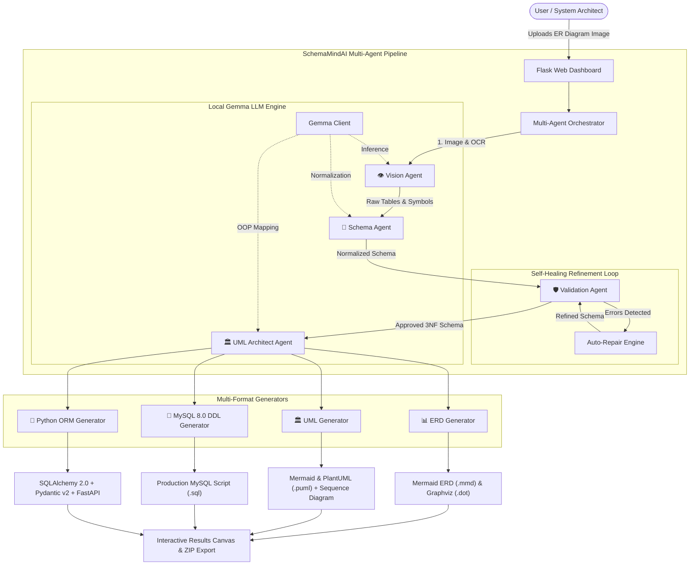
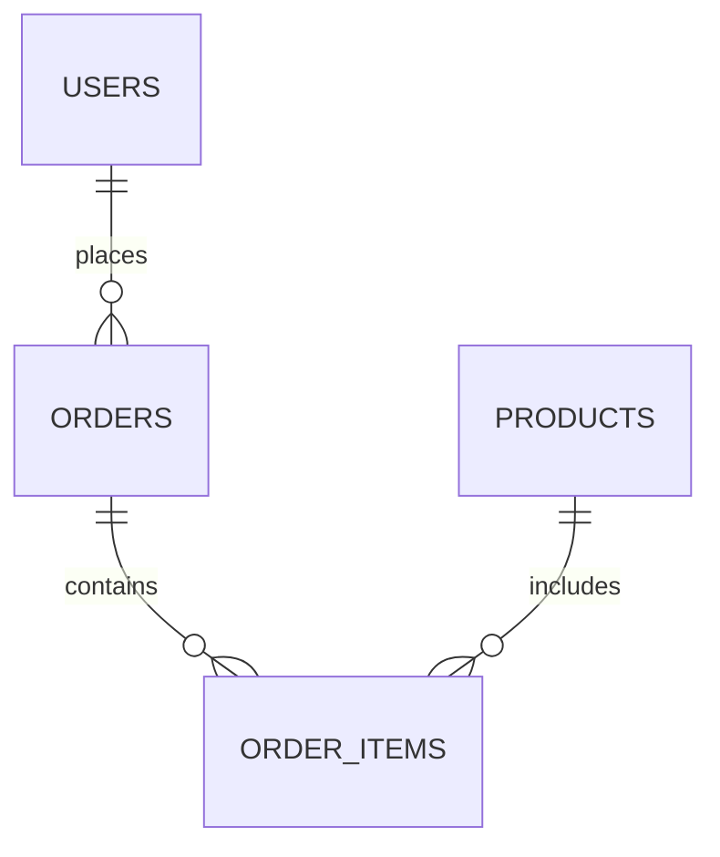

# ⚡ SchemaMindAI: ER Diagram to Multi-Agent AI UML & MySQL Generator

> **Autonomous Multi-Agent AI Engineering System powered by Local Google Gemma.**  
> Transforms raw ER diagram images (whiteboard sketches, photos, architectural drawings) into validated **Relational Database Schemas**, **MySQL 8.0 DDL Scripts**, **Object-Oriented UML Models**, and **Python ORM / API Code**.

---

## 🏆 Hackathon Project Overview

Designing and translating Entity-Relationship (ER) diagrams into functional software artifacts is traditionally slow, error-prone, and repetitive. Developers must manually translate visual cardinality into SQL foreign keys, convert types, format indexes, maintain 3NF normalization, and write duplicate Python boilerplate.

**SchemaMindAI** automates this end-to-end lifecycle using a specialized **Multi-Agent AI Architecture** powered locally by **Google Gemma**:
1. **Zero Data Leakage:** Runs 100% locally on your machine via Ollama, llama.cpp, or vLLM. No cloud API costs or proprietary schema leaks.
2. **Multi-Agent Precision:** Segregates perceptual extraction, relational normalization, semantic validation, domain modeling, and code generation across specialized agents.
3. **Iterative Self-Healing Loop:** Automatically audits schema anomalies (missing primary keys, dangling foreign keys, reserved MySQL keywords) and repairs them before code generation.
4. **Full-Stack Artifact Suite:** Generates Mermaid ERDs, PlantUML diagrams, sequence diagrams, production-ready MySQL 8.0 DDL, SQLAlchemy 2.0 models, Pydantic v2 schemas, and FastAPI CRUD routers.

---

## 🧠 System Architecture



---

## 📁 PyCharm Project Structure

```
SchemaMindAI/
│
├── app.py                      # Flask web application & REST endpoints
├── config.py                   # Environment, model & storage configuration
├── requirements.txt            # Python dependencies
├── README.md                   # Complete architectural guide & pitch
│
├── agents/                     # Multi-Agent subsystem
│   ├── __init__.py
│   ├── vision_agent.py         # Interprets visual ER diagrams & attributes
│   ├── schema_agent.py         # Normalizes types, names & foreign keys
│   ├── uml_agent.py            # Generates OOP Domain models & methods
│   ├── validation_agent.py     # 3NF rules, keyword checks & auto-repair loop
│   └── orchestrator.py         # Pipeline coordination & message passing
│
├── core/                       # Foundational services
│   ├── __init__.py
│   ├── gemma_client.py         # Local Gemma client (Ollama / vLLM / mock)
│   ├── schema_models.py        # Pydantic schemas (Table, Column, FK, ERD)
│   ├── image_processor.py      # Image normalization & contrast enhancement
│   └── workflow.py             # Pipeline state machine & execution timeline
│
├── generators/                 # Target artifact generators
│   ├── __init__.py
│   ├── erd_generator.py        # Mermaid ERD & Graphviz DOT
│   ├── uml_generator.py        # Mermaid Class, PlantUML & Sequence diagrams
│   ├── mysql_generator.py      # MySQL 8.0 DDL (InnoDB, FKs, Indexes, Seeds)
│   ├── python_generator.py     # SQLAlchemy 2.0, Pydantic v2, FastAPI router
│   └── diagram_renderer.py     # File export and bundling helpers
│
├── validators/                 # Integrity checkers
│   ├── __init__.py
│   ├── schema_validator.py     # Structural & relational consistency
│   └── sql_validator.py        # SQL syntax, quoting & delimiter checks
│
├── templates/                  # Frontend Jinja2 templates
│   ├── index.html              # Drag-and-drop upload & preset launcher
│   ├── results.html            # Tabbed dashboard with live Mermaid canvas
│   └── review_schema.html      # Human-in-the-loop schema editor
│
├── static/                     # Web assets
│   ├── css/style.css           # Modern dark-mode styling
│   └── js/app.js               # Interactive tabs, copy clipboard, drop zone
│
├── uploads/                    # Incoming diagram storage
├── outputs/                    # Export directory for generated code
└── tests/                      # Automated test suite
    ├── __init__.py
    ├── test_schema.py          # Schema normalization & topological sort tests
    ├── test_mysql.py           # MySQL DDL syntax & foreign key tests
    └── test_generators.py      # ERD, UML, and Python generator tests
```

---

## 🚀 Gemma Setup: Run Locally

SchemaMindAI is designed to run completely on your local workstation.

### Option 1: Quick Local Setup via Ollama (Recommended)
1. Install [Ollama](https://ollama.ai/).
2. Pull Google Gemma:
   ```bash
   # Gemma 2 9B (Best performance and schema reasoning)
   ollama pull gemma2:9b

   # OR Gemma 2 2B (Lightweight for fast CPU/laptop inference)
   ollama pull gemma2:2b
   ```
3. Start the Ollama local daemon:
   ```bash
   ollama serve
   ```
4. By default, `config.py` points to `http://localhost:11434` with `gemma2:9b`.

### Option 2: OpenAI-Compatible Local Endpoint (vLLM / LM Studio / llama.cpp)
Set in your `.env` or `config.py`:
```env
LLM_PROVIDER=openai_compatible
OPENAI_COMPATIBLE_BASE_URL=http://localhost:8000/v1
GEMMA_MODEL=gemma2-9b-it
```

### Option 3: Offline / Demo Mock Mode
If running during a presentation without a GPU:
```env
LLM_PROVIDER=mock
```
SchemaMindAI includes a rich built-in schema inference engine that functions 100% offline without needing Ollama active.

---

## 💻 PyCharm Setup Guide

1. **Open Project in PyCharm:**
   - Launch PyCharm.
   - Click **Open** and select the folder `C:\Users\Win10\SchemaMindAI`.

2. **Configure Python Interpreter:**
   - Go to **File** → **Settings** → **Project: SchemaMindAI** → **Python Interpreter**.
   - Click **Add Interpreter** → **Add Local Interpreter...** → **Virtualenv**.
   - Choose Python 3.10, 3.11, or 3.12.

3. **Install Dependencies:**
   - Open the **Terminal** tab in PyCharm and execute:
     ```bash
     pip install -r requirements.txt
     ```

4. **Run the Application:**
   - Right-click `app.py` in PyCharm and select **Run 'app'**, or execute:
     ```bash
     python app.py
     ```
   - Open your browser at:
     ```
     http://127.0.0.1:5000
     ```

5. **Run the Test Suite:**
   - In the PyCharm Terminal:
     ```bash
     pytest tests/ -v
     ```

---

## 🔬 Multi-Agent Roles & Architecture

| Agent | Core Responsibility | Key Logic |
| :--- | :--- | :--- |
| **👁️ Vision Agent** | Visual feature extraction | Discovers entity boxes, column names, PK indicators, crow's foot connectors, and cardinalities. |
| **📐 Schema Agent** | Relational normalization | Maps types to canonical SQL, enforces snake_case, discovers foreign keys based on `_id` heuristics, and ensures primary keys. |
| **🛡️ Validation Agent** | Integrity & SQL audit | Detects circular dependencies, verifies foreign key targets, flags 90+ MySQL reserved keywords, and runs automated repairs. |
| **🏛️ UML Agent** | OOP Domain modeling | Translates relational models to Class Diagrams, injects domain methods (`save()`, `findById()`, `authenticate()`), and maps associations. |
| **⚡ Generators** | Multi-target compilation | Emits Mermaid ERDs, PlantUML scripts, sequence diagrams, MySQL 8.0 DDL, SQLAlchemy 2.0 models, Pydantic v2 schemas, and FastAPI routes. |

---

## 📦 What the System Generates

### 1. Interactive Mermaid ER Diagram
Renders directly in the browser with cardinalities:


### 2. UML Class Diagram & Sequence Diagram
- Class diagrams featuring private attributes, domain methods, and stereotypes.
- Transactional CRUD sequence diagrams showing UI → Controller → Service → Repository → MySQL execution.

### 3. Production MySQL 8.0 Script
- `CREATE DATABASE ... DEFAULT CHARSET=utf8mb4`
- `DROP TABLE IF EXISTS` in reverse dependency order
- Tables created in topological order (parents before children)
- Constraints: `FOREIGN KEY (...) REFERENCES ... ON DELETE CASCADE ON UPDATE CASCADE`
- Foreign key performance indexes
- Realistic sample seed data for testing

### 4. Python Backend Code
- **SQLAlchemy 2.0:** Modern Declarative Base with `Mapped[]`, `mapped_column()`, and `relationship()`.
- **Pydantic v2:** `BaseModel` classes with `ConfigDict(from_attributes=True)`.
- **FastAPI Router:** Full CRUD boilerplate skeleton ready to run.

---

## 🛡️ License & Acknowledgements
- Developed for Hackathon Multi-Agent AI System demonstration.
- Built with Google Gemma, Flask, Mermaid.js, and Pydantic.
